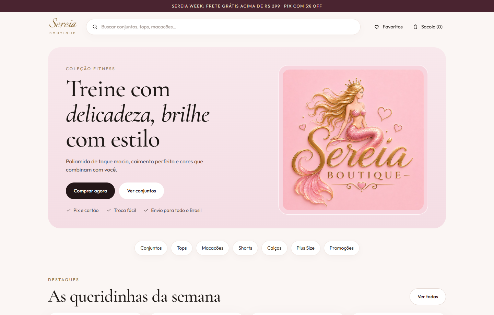
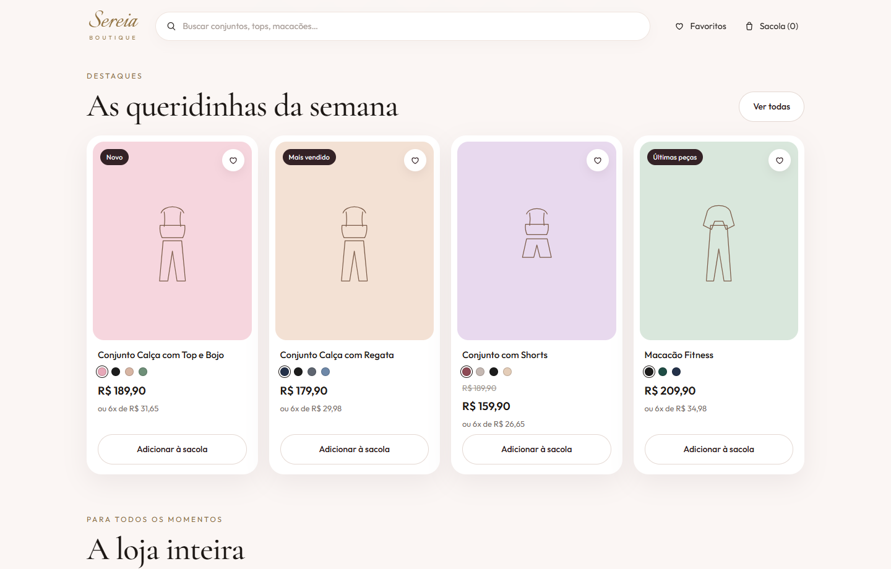
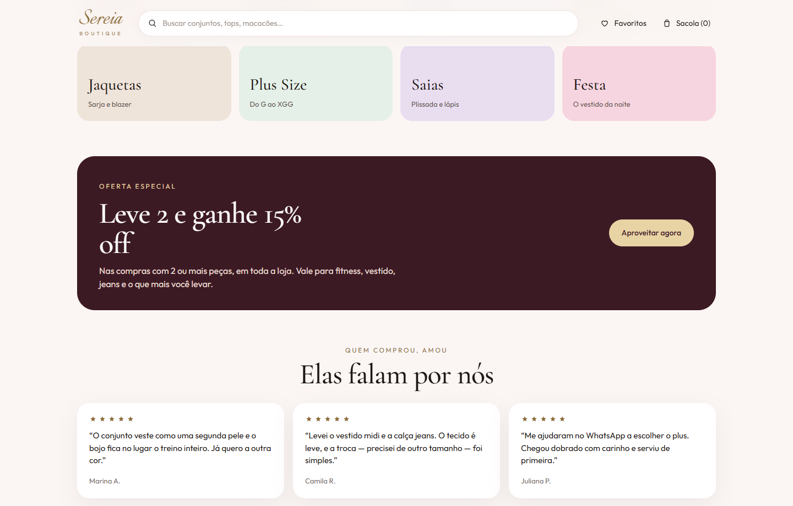
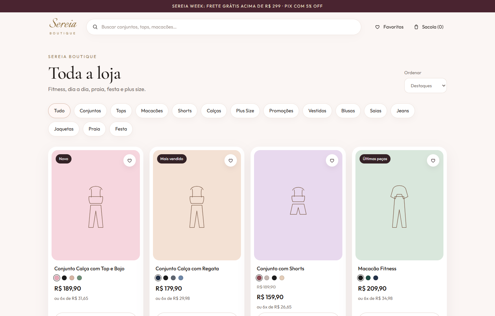
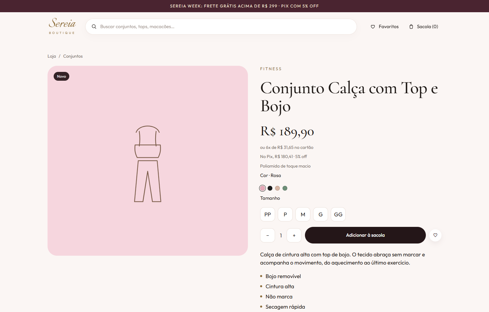
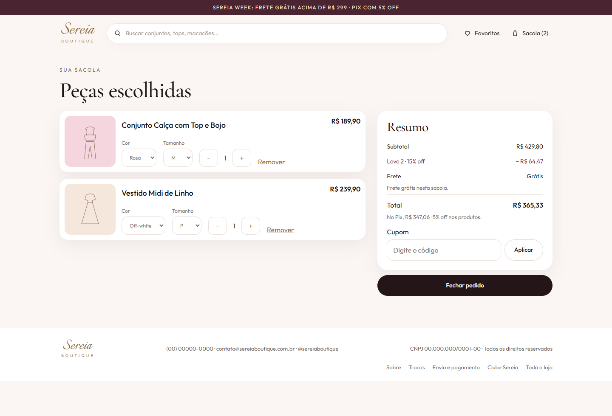
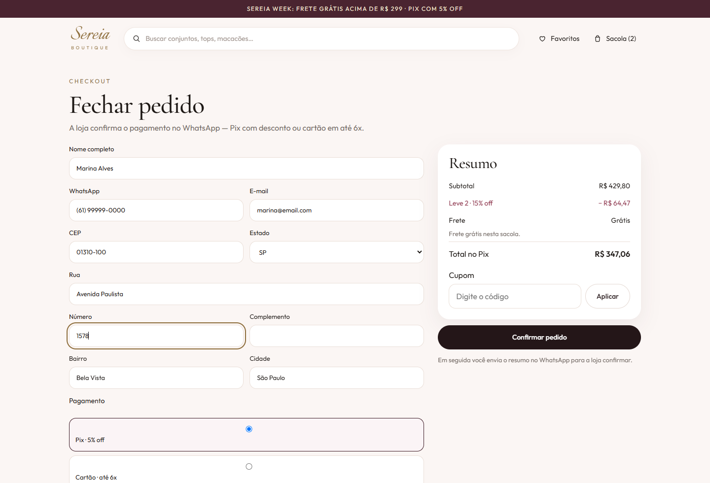
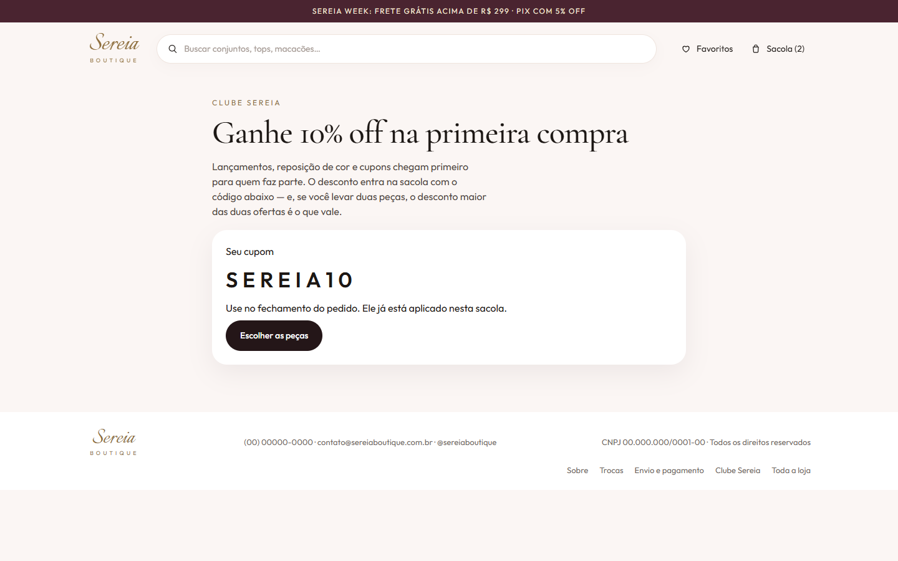

# Sereia Boutique

Loja de roupas em React, no visual da proposta: fitness na vitrine e o resto do guarda-roupa na mesma loja — vestidos, jeans, praia, festa, jaquetas e plus size.

O site é estático. Roda no navegador, publica na Netlify e confirma o pedido pelo WhatsApp.

## Telas

### Início

Faixa de frete e Pix, busca, favoritos, sacola e a coleção fitness.



### Queridinhas da semana

Os quatro destaques da proposta, com selo, cor, preço e parcelamento.



### Oferta, categorias e depoimentos

A loja inteira (fitness, vestidos, jeans, praia, festa e plus size), a promoção de duas peças e os depoimentos.



### Catálogo

Todas as categorias, com ordenação por destaque ou preço.



### Peça

Cor, tamanho, Pix, parcelas e guia de medidas.



### Sacola

Duas ou mais peças ganham 15% off. Acima de R$ 299 o frete sai de graça.



### Fechamento

O CEP preenche a rua, o bairro e a cidade. O Pix aparece com o desconto já calculado.



### Clube Sereia

Quem entra recebe o cupom da primeira compra.



### Celular

A mesma página se reorganiza: busca embaixo do logo e sacola no ícone.


## Como abrir no computador

Na pasta do projeto:

```bash
npm install
npm run dev
```

Abra http://localhost:5173/

Para gerar a pasta que a Netlify publica:

```bash
npm run build
```

O resultado fica em `dist`.

## Publicar na Netlify

O arquivo `netlify.toml` já define o build.

1. Crie um site novo em [app.netlify.com](https://app.netlify.com) e envie esta pasta (ou conecte o repositório).
2. Confira:
   - **Build command:** `npm run build`
   - **Publish directory:** `dist`
3. Publique.

As rotas (`/loja`, `/produto/...`, `/sacola`, `/checkout`) continuam abrindo direto, por causa do redirect para `index.html`.

Dois formulários ficam registrados na Netlify depois do primeiro deploy:

- **clube** — nome e e-mail de quem pede o cupom
- **pedidos** — resumo do pedido confirmado no site

O pagamento em si é combinado no WhatsApp. O botão do pedido abre a conversa com as peças, o endereço e o total.

## O que dá para ajustar

Tudo que é da loja, e não do layout, está em dois arquivos.

`src/data/store.js` — WhatsApp, e-mail, Instagram, CNPJ, frete, Pix, parcelas e cupom. Os valores de hoje são um ponto de partida:

| Regra | Valor |
| --- | --- |
| Frete grátis | acima de R$ 299 |
| Frete abaixo disso | R$ 24,90 |
| Pix | 5% off nos produtos |
| Cartão | até 6x |
| Duas peças ou mais | 15% off |
| Primeira compra (Clube) | 10% off, cupom `SEREIA10` |
| Troca | 7 dias, primeira troca grátis |
| Postagem | até 2 dias úteis |

Troque o WhatsApp, o e-mail, o Instagram e o CNPJ antes de publicar. Hoje estão como `(00) 00000-0000`, `contato@sereiaboutique.com.br`, `@sereiaboutique` e `00.000.000/0001-00`.

`src/data/products.js` — nome, preço, cores, tamanhos, estoque e texto de cada peça. Para usar uma foto no lugar do desenho, salve o arquivo em `public/produtos` e acrescente na peça:

```js
image: "/produtos/conjunto-rosa.jpg"
```

## O que a cliente consegue fazer

- Buscar por nome, tecido ou categoria
- Filtrar por conjuntos, tops, macacões, shorts, calças, plus size, promoções, vestidos, blusas, saias, jeans, jaquetas, praia e festa
- Guardar favoritos e montar a sacola (fica salva neste navegador)
- Escolher cor e tamanho, inclusive na sacola
- Ganhar o desconto de duas peças ou usar o cupom do clube — entra o desconto maior
- Fechar o pedido com Pix ou cartão e enviar o resumo no WhatsApp

## Pastas

```
src/components   cabeçalho, rodapé, card, sacola
src/pages        início, loja, peça, sacola, checkout, clube
src/data         dados da loja e das peças
public           logo, favicon e fotos futuras
docs/prints      os prints deste README
netlify.toml     build e rotas da Netlify
```
